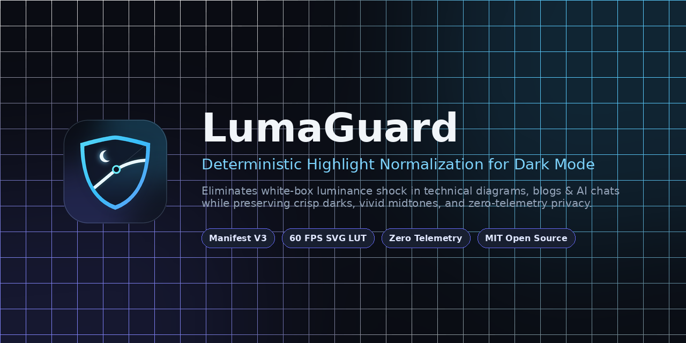
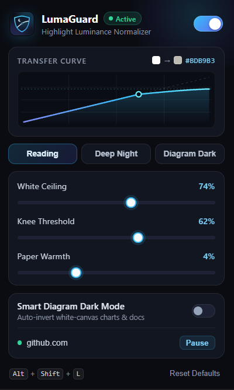

<p align="center">
  
</p>

<p align="center">
  <strong>Deterministic Highlight Normalization for Dark-Mode Readers, Developers &amp; Students.</strong><br/>
  Kill blinding white-box glare in blogs, documentation, and AI chats—without ruining image contrast or photographs.
</p>

<p align="center">
  
  
  
  
</p>

---

## The Problem: Local Luminance Shock

When reading technical blogs, computer networking documentation, research papers, or AI chat responses in dark mode (`#121212` – `#1E1E1E`), your pupils dilate to adapt to the low ambient screen luminance.

The moment an embedded diagram, chart, or screenshot with a pure `#FFFFFF` canvas scrolls into view, your eyes experience **Local Luminance Shock** (commonly called the *"white-box flashbang"* effect):

- **Veiling Glare & Halation:** High-luminance white blocks scatter light across surrounding dark text, making adjacent paragraphs hard to read and focus on.
- **Pupillary Fatigue:** Constantly shifting between dark UI text and pure white embedded images forces rapid, tiring eye strain during long study or coding sessions.

### Why Existing Tools Fall Short

| Existing Approach | Mechanism | Limitation |
| :--- | :--- | :--- |
| **Global Brightness Dimmers** | Flat CSS `brightness(0.7)` across the entire image | Crushes dark text, diagrams, and midtones into muddy grey while leaving whites looking washed out. |
| **Blind CSS Inversion** | `invert(0.9) hue-rotate(180deg)` on all images | Works on diagrams, but corrupts real photographs and human faces into eerie negatives. |
| **OS-Level Color Filters** | Global 5×5 display matrix or screen dimmers | Dims the entire display, making already-dark UI text unreadable. |

---

## The Solution: LumaGuard

**LumaGuard** solves this deterministically using a **piecewise Soft-Knee Highlight Compression Lookup Table (LUT)** rendered natively by the browser's GPU compositor via an inline SVG `<feComponentTransfer>` pipeline—no probabilistic AI guesswork, no CORS failures, and zero frame drops.

### How the Algorithm Works

1. **1:1 Preservation of Darks & Midtones**  
   Every pixel channel value $x \in [0, 1]$ below the user-defined **Knee Threshold ($T$)** passes through untouched ($y = x$). Black text, dark lines, and saturated colors inside diagrams retain **100% original contrast and clarity**.

2. **Smooth Highlight Roll-Off**  
   Pixels above $T$ (blinding whites and near-white canvases) are smoothly compressed toward the **White Ceiling ($C$)** using a deterministic ease-out curve:

   $$y = \begin{cases} x & \text{if } x \le T \\ T + (C - T) \cdot \left(1 - \left(1 - \frac{x - T}{1 - T}\right)^{1.35}\right) & \text{if } x > T \end{cases}$$

3. **Optional Paper Warmth**  
   Subtly attenuates only the blue and green channels *above the knee threshold*, turning harsh blue-white `#FFFFFF` backgrounds into calm warm-paper tones while keeping dark colors completely neutral.

4. **Deterministic Smart Diagram Dark Mode (Opt-In)**  
   Evaluates downsampled image pixels using ITU-R BT.709 relative luminance ($Y = 0.2126R + 0.7152G + 0.0722B$), border whiteness ratio, and 4-bit color quantization complexity:
   - Triggers hue-preserving dark inversion **only** when `whiteRatio > 40%`, `borderWhiteRatio > 70%`, and `uniqueColorBuckets < 185` (synthetic technical diagrams).
   - Never corrupts photographs; gracefully falls back to the SVG Highlight Clamp LUT on cross-origin images.

---

## Extension View & Features

<p align="center">
  
</p>

- **Real-Time Transfer Curve Visualizer:** See the exact luminance clamping curve and live `#FFFFFF → #BDB9B3` output swatch update as you adjust sliders.
- **One-Click Reading Presets:** Switch instantly between **Reading**, **Deep Night**, and **Diagram Dark**.
- **Per-Site Pause Control:** Pause or resume LumaGuard on any specific domain in one click.
- **Instant Keyboard Toggle:** Press `Alt + Shift + L` anytime to compare before vs. after.
- **Privacy-First Architecture:** Strictly Manifest V3, minimal permissions (`storage`, `activeTab`), zero analytics, zero outbound network requests.

---

## Installation

### Load Unpacked (Chrome, Brave, Edge, Arc)

1. Download the latest release ZIP (or clone this repository):
   ```bash
   git clone https://github.com/TheBhavyaGohil/LumaGuard.git
   ```
2. Open your browser and navigate to `chrome://extensions`.
3. Enable **Developer mode** in the top-right corner.
4. Click **Load unpacked** and select the `extension/` folder.
5. Pin **LumaGuard** to your toolbar and open any dark-mode blog or AI chat.

---

## Project Structure

```text
LumaGuard/
├── extension/                  # Production Chrome Web Store bundle (Manifest V3)
│   ├── manifest.json           # Minimal permissions (storage, activeTab)
│   ├── content.js              # SVG LUT injector & deterministic diagram classifier
│   ├── popup.html              # Glassmorphic extension UI
│   ├── popup.css               # Obsidian minimalist dark styling
│   ├── popup.js                # Live SVG curve renderer & state management
│   └── icons/                  # 16px, 32px, 48px, and 128px PNG icons
├── assets/                     # Vector logo, popup preview, promo tile & banner
│   └── extension-popup.png     # Extension popup UI screenshot
├── PRIVACY.md                  # Zero-data-collection privacy policy
├── CONTRIBUTING.md             # Contribution guidelines
├── LICENSE                     # MIT License
└── README.md
```

---

## Privacy

LumaGuard executes **100% locally** inside your browser. It collects no browsing history, transmits no image data, and makes zero external network requests. See [PRIVACY.md](PRIVACY.md) for full details.

---

## Author & License

Created by **Bhavya N Gohil** ([@TheBhavyaGohil](https://github.com/TheBhavyaGohil)).  
Released under the [MIT License](LICENSE).
